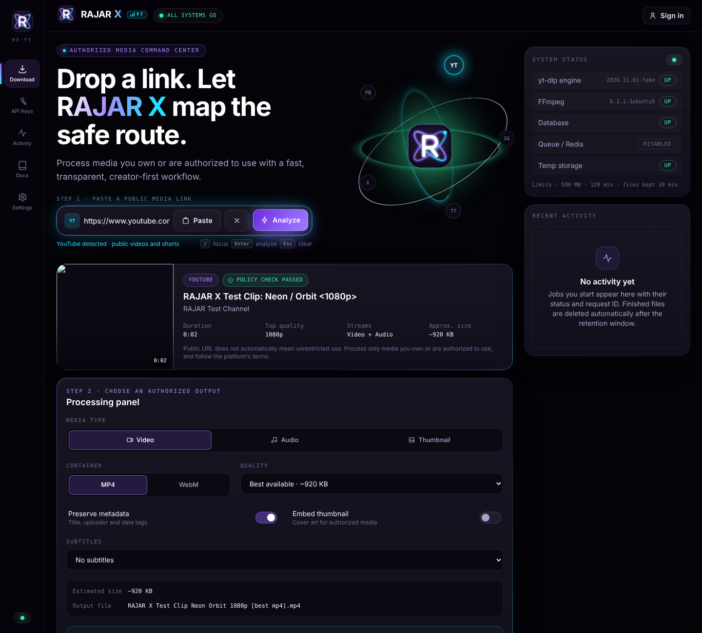
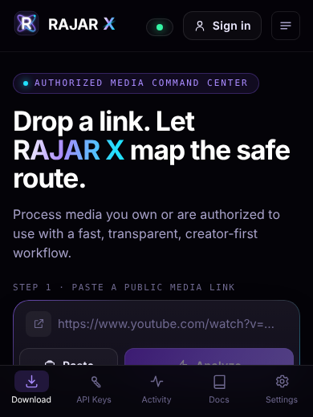
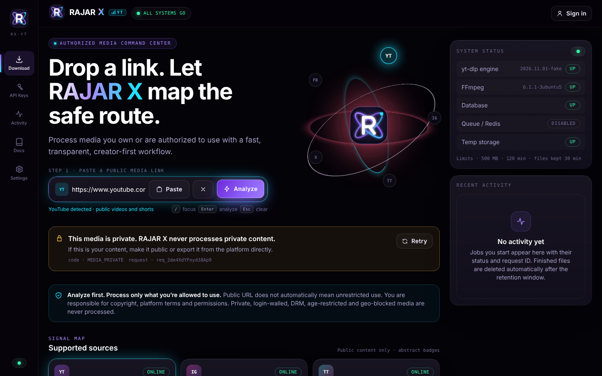

# RAJAR X YT

## 🚀 Host on RAJAR X HOSTING (one upload, no setup)

1. In RAJAR X HOSTING create a project (runtime **Docker** — recommended — or **Node.js**).
2. Upload this ZIP. That's it: everything installs and starts automatically.
3. Open the project subdomain and **register — the first account becomes the owner/admin.**

What happens automatically:
- **Database:** built-in file database stored on the VPS (`/data/rajar-x-yt/database.json`, survives redeploys and new uploads; included in hosting backups). No PostgreSQL/Redis server needed. If you enable the PostgreSQL add-on in the project, it is used instead and its tables are created on start.
- **Secrets:** `SESSION_SECRET` / `API_KEY_PEPPER` are generated once and saved in `/data/rajar-x-yt/secrets.json`.
- **Public URL:** the project subdomain is detected from the hosting (`PUBLIC_BASE_URL`), proxy trust is set automatically.
- **yt-dlp + FFmpeg:** Docker runtime installs them from Debian/pip; Node.js runtime downloads them into `./bin` during `npm install` (`scripts/install-media-tools.mjs`).
- `rajarx.json` tells the hosting how to install, build and start (port 8080).

Optional env vars (project → Env vars): `OWNER_EMAIL`, `ALLOWED_HOSTS` (custom domains), `MEDIA_MAX_FILE_SIZE`, `USER_DAILY_JOB_QUOTA`, … see `.env.example`.

---


**Drop a link. Let RAJAR X map the safe route.**

RAJAR X YT is a branded, production-grade dashboard for **analyzing public media links and processing media you own or are authorized to use**. It includes a personal API-key platform for your own integrations, scripts and WhatsApp MD bots.



| Mobile | Restricted media fails safely |
|---|---|
|  |  |

> **Safe-use model.** RAJAR X uses `yt-dlp` only as an authorized media-processing engine. It never bypasses DRM, paywalls, private accounts, login walls, age gates, geo-blocks, rate limits or other access controls. It never signs in to platforms and never accepts cookies. Private, members-only, login-required, DRM-protected, age-restricted, geo-restricted, live and playlist/batch requests **fail safely** with a clear error code. A public URL does not automatically mean unrestricted use. Users must confirm they own the media or are authorized to process it.
>
> RAJAR X YT is not affiliated with YouTube, Instagram, TikTok, Facebook, X, or other third-party platforms.

---

## Contents

1. [Features](#features)
2. [Architecture](#architecture)
3. [Local development](#local-development)
4. [Configuration](#configuration)
5. [VPS deployment (Docker)](#vps-deployment-docker)
6. [Bare-metal deployment (systemd)](#bare-metal-deployment-systemd)
7. [Operations](#operations)
8. [Security model](#security-model)
9. [Testing](#testing)
10. [Verification status](#verification-status)

---

## Features

- **Command-center UI.** React, TypeScript and Tailwind v4. Animated CSS-3D orbital RX core, holographic cards, moving grid, scan lines and a light particle field. Particles are skipped on low-end devices, and all motion respects `prefers-reduced-motion`. Layout: left brand rail, analyzer stage and right status/activity panel on desktop; two columns with a collapsible panel on tablet; bottom navigation, stacked controls and a sticky process button on mobile.
- **URL analyzer.** Client-side pre-check, then server-side validation: allow-list, platform detection, private/login/batch path rejection and SSRF/DNS checks. Only after that does it run a metadata-only `yt-dlp` call and apply a policy gate. It shows title, thumbnail, duration, uploader, formats, size estimates and safe-use status. Nothing starts automatically.
- **Processing panel.** Video (MP4/WebM, best/2160/1440/1080/720/480 — offered only when the source really has that rung), audio (MP3/M4A/WAV, original/highest/EBU R128-normalized, bitrate) and thumbnail. Also: metadata and thumbnail embedding, uploader-published subtitles only, size estimate, output filename preview, rights confirmation, live progress, cancel, collapsible technical log, and distinct queued, active, ready, completed, blocked, failed, cancelled and expired states.
- **Job system.** Explicit state machine, atomic job claiming, bounded concurrency, exponential-backoff retry for transient errors only, cancellation (cross-instance with Redis), per-user daily and concurrent quotas, crash recovery and automatic temp-file cleanup.
- **API-key platform.** `rjar_live_` keys with about 238 bits of entropy, shown once, stored as an HMAC-SHA-256 hash with a pepper. Includes masked prefixes, scopes, per-key rate limits, revoke/regenerate, last-used tracking and per-user key limits.
- **Public API v1, webhooks, docs.** Uses the `{ success, requestId, data, error }` envelope. Webhooks are signed. In-app docs include cURL, JavaScript and Python examples and a WhatsApp MD integration. See `docs/API.md`.
- **Accounts and admin.** Email/password accounts (scrypt), server-side sessions, owner/admin roles, and an admin control center: totals, health of yt-dlp/FFmpeg/Redis/DB/storage, redacted logs, maintenance toggle, global size/duration limits, abusive-key revocation and request-ID inspection.
- **Production plumbing.** Helmet CSP, CORS allow-list, CSRF double-submit plus Origin check, Host-header guard, Zod validation, body limits, audit trail with hashed IPs, `/api/health`, `/api/ready`, `/api/version`, graceful shutdown, Docker, Nginx, systemd, backups and SEO metadata.

## Architecture

```
client/                 React + Vite + Tailwind v4 SPA
  src/components/       brand (SVG logo/emblem), visual (orbital core, backdrop), layout, ui primitives
  src/features/         download (analyzer + processing), keys, activity, docs, settings, admin, auth, legal
  public/               favicon, app icons, OG image, manifest
shared/                 Contracts used by both sides: error catalog, platforms, Zod schemas, types
server/
  config.ts             Zod-validated environment (refuses to boot in prod without secrets)
  app.ts                Express wiring: security headers → host guard → CORS → session → audit → rate limit → CSRF → routes
  bootstrap.ts          Builds services (store, queue, engine, rate limiter) — shared by server and tests
  security/             URL policy, SSRF/IP rules, API keys, passwords, rate limiting, secret box
  media/                runProcess (spawn, timeouts, process-group kill), yt-dlp args, metadata policy, error maps, engine
  jobs/                 state machine, MemoryQueue, RedisQueue, cleanup worker
  services/             auth, API keys, analysis, jobs, webhooks
  db/                   Drizzle schema, Postgres store, in-memory store, migrations runner
  http/                 middleware and route modules (system, auth, media, account, admin, v1, seo)
migrations/             SQL migrations (Drizzle journal format)
tests/                  node:test suites, fake yt-dlp fixture (backed by real FFmpeg), production smoke test
deploy/                 nginx.conf, systemd unit, logrotate, backup script
examples/whatsapp-md-bot  Reference bot (allow-lists, cooldown, retries, size caps)
```

**Request flow for processing.** `POST /api/jobs` checks maintenance mode, engine health and quotas. It then re-validates the URL and DNS, runs the metadata policy (cached for 10 minutes), checks the option and size, writes a `queued` job and enqueues it. A worker atomically claims the job (`queued → active`) and re-checks DNS right before spawning. It then runs `yt-dlp` with an argument array (URL after `--`, `--ignore-config`, `--no-cookies`, `--max-filesize`), streams progress, optionally normalizes audio with FFmpeg, verifies the output file exists and is within limits, and only then marks the job `ready`.

## Local development

Requirements: Node 20.11+, FFmpeg, yt-dlp (`pipx install yt-dlp` or `python3 -m pip install -U yt-dlp`). PostgreSQL and Redis are optional in development.

```bash
npm install
cp .env.example .env            # for dev you can leave DATABASE_URL/REDIS_URL empty
# edit .env: NODE_ENV=development, PUBLIC_BASE_URL=http://localhost:5173, OWNER_EMAIL=you@example.com
npm run dev                     # API on :8080, Vite on :5173 (proxying /api)
```

Without `DATABASE_URL` the server uses an in-memory store, and without `REDIS_URL` it uses the in-process queue and rate limiter. Without yt-dlp or FFmpeg the UI shows a setup warning and those features fail with `YTDLP_UNAVAILABLE` or `FFMPEG_UNAVAILABLE`.

Register with `OWNER_EMAIL` to get the owner role and the **Admin** section.

Useful scripts:

| Script | Purpose |
|---|---|
| `npm run typecheck` | Server, tests and client type checks |
| `npm run lint` / `npm run format:check` | ESLint (typescript-eslint, react-hooks) and Prettier |
| `npm test` | Full test suite (needs FFmpeg on PATH) |
| `npm run build` | Vite client build to `dist/client` and server build to `dist/server` |
| `npm run check` | All of the above |
| `npm run db:migrate` | Apply SQL migrations (`DATABASE_URL` required) |
| `npm run db:generate` | Generate a new migration after editing `server/db/schema.ts` |
| `BASE_URL=… npm run test:smoke` | Production smoke tests |
| `npm run brand:assets` | Regenerate PNG icons and the OG image from SVG |

## Configuration

All settings are environment variables. `.env.example` documents every one. Key settings:

| Variable | Default | Notes |
|---|---|---|
| `PUBLIC_BASE_URL` | `http://localhost:5173` | Drives CORS, CSRF origin checks, the Host allow-list, canonical URLs and the sitemap |
| `YTDLP_BIN` / `FFMPEG_BIN` | `yt-dlp` / `ffmpeg` | Binary paths. Health is checked at boot and every 60 s |
| `MEDIA_TEMP_DIR` | `/tmp/rajar-x-media` | Outside the web root; mode 0700; never served directly |
| `MEDIA_MAX_FILE_SIZE` / `MEDIA_MAX_DURATION` | `500M` / `7200` | Admins can override these at runtime |
| `MEDIA_JOB_TIMEOUT_MS` | `900000` | Hard kill of the whole process group |
| `MEDIA_RETENTION_MINUTES` | `30` | Files are deleted afterwards by the cleanup worker |
| `MEDIA_CONCURRENCY` | `2` | Worker slots per instance (bounded) |
| `RATE_LIMIT_*`, `USER_*`, `ANON_*` | see file | Per-IP, per-user, per-key and anonymous limits |
| `DATABASE_URL` | — | PostgreSQL. Required in production |
| `REDIS_URL` | — | Enables the Redis queue and shared rate limits |
| `SESSION_SECRET`, `API_KEY_PEPPER` | — | 32 or more characters each, required in production. Changing the pepper invalidates all API keys |
| `OWNER_EMAIL` | — | This account becomes `owner` on registration |
| `COOKIE_SAMESITE` | `lax` | Set `none` for embedded HTTPS previews (forces `Secure`). Pair with `CSP_FRAME_ANCESTORS` |
| `ADMIN_SCOPE_ENABLED` | `false` | Allows owner/admin accounts to mint `admin`-scoped keys |

## VPS deployment (Docker)

Tested layout: Ubuntu 22.04/24.04, 2+ vCPU, 4 GB+ RAM, Docker Engine with the compose plugin.

```bash
# 1. Firewall: only SSH and HTTP(S) are public. Postgres and Redis stay on the internal Docker network.
sudo ufw default deny incoming && sudo ufw allow OpenSSH && sudo ufw allow 80,443/tcp && sudo ufw enable

# 2. Code and config
git clone <your repo> /opt/rajar-x-yt && cd /opt/rajar-x-yt
cp .env.example .env
#   set PUBLIC_BASE_URL=https://your.domain, OWNER_EMAIL, SESSION_SECRET, API_KEY_PEPPER
#   add POSTGRES_PASSWORD=<strong password> (used by docker-compose.yml)
openssl rand -base64 48   # run once per secret

# 3. TLS certificate (Let's Encrypt). Replace rajarx.example.com in deploy/nginx.conf first.
sudo apt install -y certbot && sudo certbot certonly --standalone -d your.domain

# 4. Build and start
docker compose up -d --build
docker compose exec app node dist/server/server/db/migrate.js

# 5. Verify
curl -fsS https://your.domain/api/health
BASE_URL=https://your.domain npx tsx tests/smoke/smoke.ts
```

Then register with `OWNER_EMAIL` and open **Admin**.

**What persists:** only the `pgdata` volume (the database). Temporary media lives in a tmpfs at `/tmp` inside the read-only, non-root (`uid 10001`), capability-dropped app container, and is wiped on restart. Redis runs with persistence disabled because it holds only queue and rate-limit state.

**HTTPS notes:** Nginx terminates TLS, redirects HTTP to HTTPS, sets `X-Forwarded-*` and `X-Request-Id`, limits bodies to 64 KB, and logs paths without query strings or auth headers. The app sends HSTS in production. Renew certificates with `certbot renew` from a cron or systemd timer, then `docker compose exec nginx nginx -s reload`.

**Updating yt-dlp:** platforms change often. Rebuild regularly with `docker compose build --no-cache app && docker compose up -d app`, or pin a release with `--build-arg YTDLP_VERSION=<tag>`.

**Scaling:** run more `app` replicas behind Nginx. With `REDIS_URL` set, the queue, cancellation and rate limits are shared across instances. Each replica runs `MEDIA_CONCURRENCY` workers.

## Bare-metal deployment (systemd)

```bash
sudo apt install -y nodejs npm ffmpeg python3-venv postgresql redis-server nginx
sudo python3 -m venv /opt/yt-dlp && sudo /opt/yt-dlp/bin/pip install -U yt-dlp   # YTDLP_BIN=/opt/yt-dlp/bin/yt-dlp
sudo -u postgres createuser -P rajarx && sudo -u postgres createdb -O rajarx rajarx
sudo useradd --system --home /opt/rajar-x-yt rajarx
cd /opt/rajar-x-yt && npm ci && npm run build && npm prune --omit=dev
sudo -u rajarx env $(cat .env | xargs) node dist/server/server/db/migrate.js
sudo cp deploy/rajar-x.service /etc/systemd/system/ && sudo systemctl enable --now rajar-x
sudo cp deploy/logrotate-rajar-x /etc/logrotate.d/rajar-x
```

Point Nginx at `127.0.0.1:8080` (see `deploy/nginx.conf`) and keep Redis bound to localhost (`bind 127.0.0.1` in `redis.conf`).

## Data policy — only accounts are stored

| Data | Where it lives |
|---|---|
| Users, sessions, API keys (hash + masked prefix + limits), webhook settings, admin settings | Persistent store (`database.json` in `DATA_DIR`, or PostgreSQL) |
| Job/activity history, audit trail, rate-limit counters | **Memory only** — gone after a restart (`AccountsOnlyStore`) |
| Processed media | Temp dir only; **deleted right after its one-time download**, or after `MEDIA_RETENTION_MINUTES` if never downloaded |

Older `database.json` files and PostgreSQL databases that still contain jobs or audit rows are purged automatically (file store on next save, PostgreSQL by migration `0001_key_limits`).

## API key limits (admin)

- Users pick a preset limit (30/60/120/300 per minute).
- Owner/admin can open **Admin → API keys → Request limit** and set any custom limit (1–1,000,000/min) or **Unlimited** for any key, or choose them when creating their own keys. API: `PUT /api/admin/keys/:id/limit` with `{"rateLimitPerMinute": 5000}` or `{"rateLimitPerMinute": null}`.
- Unlimited keys skip the per-key limit, the per-IP media limit and the daily/concurrent job quotas. Server-wide processing is still bounded by `MEDIA_CONCURRENCY` — extra jobs wait in the queue.
- Keys work in the `Authorization: Bearer` header or as a URL parameter (`?key=` / `?api_key=`), e.g. `GET /api/v1/analyze?url=…&key=…` or `GET /api/v1/jobs/<id>/file?key=…`. URL keys are stripped and redacted from logs, but prefer the header — links leak through history and proxies.

## Operations

| Endpoint | Meaning |
|---|---|
| `GET /api/health` | Liveness plus component health (yt-dlp, FFmpeg, DB, Redis, storage) and setup warnings. Always 200 while serving |
| `GET /api/ready` | 200 only when the DB and temp storage are usable (and Redis, if configured). Used by the Docker healthcheck |
| `GET /api/version` | App name, version, API version, Node version, start time |

- **Graceful shutdown:** on SIGTERM the server stops accepting connections, aborts running jobs (which return to `queued`), drains the queue, then closes Redis and the DB. A 30 s safety timeout applies. tini forwards signals in Docker.
- **Cleanup worker:** runs every 60 s. It deletes expired outputs (status becomes `expired`), orphaned job directories and expired sessions.
- **Logs:** structured JSON on stdout/stderr. Every line is redacted (API keys, bearer tokens, cookies, passwords, signed URL parameters). The admin panel shows the last 500 entries. Docker rotates logs with `json-file` (`max-size` 20 MB × 5). Bare metal uses `deploy/logrotate-rajar-x`.
- **Backups:** `deploy/backup.sh` writes nightly `pg_dump` custom-format archives and prunes after 14 days. Copy them off-host. Restore with `pg_restore -d rajarx --clean <file>`. Media is intentionally never backed up.
- **Secret rotation:** rotating `SESSION_SECRET` signs everyone out and invalidates webhook secrets (users rotate them in Settings). Rotating `API_KEY_PEPPER` invalidates **all** API keys, so announce it and have users regenerate.
- **Maintenance:** Admin → *Processing enabled* off pauses new jobs (`SERVER_MAINTENANCE`) while analysis keeps working.

## Security model

| Concern | Implementation |
|---|---|
| Command injection | `spawn` with `shell: false` and argument arrays. Format selectors are built only from enumerated options. URL is always after `--`. `--ignore-config` blocks config-file injection |
| Secrets in child processes | yt-dlp and FFmpeg receive a minimal environment (no DB URL, session secret or pepper) |
| SSRF / DNS rebinding | Domain allow-list, no IP literals or non-standard ports, every resolved A/AAAA record must be public (IPv4, IPv6, mapped, NAT64, 6to4, Teredo), DNS re-checked before every spawn, Host-header guard on this server |
| Restricted media | Path rules (stories, DMs, groups, playlists), signed-URL rejection, metadata policy (`availability`, `age_limit`, `live_status`, `has_drm`, duration) and stderr mapping. Restrictions become `blocked` jobs and are never retried |
| Resource abuse | Timeouts with process-group kill, `--max-filesize` plus post-check, duration limit, bounded concurrency, per-IP, per-user, per-key and login limits, quotas, 16 KB JSON bodies |
| API keys | 238-bit random keys, HMAC-SHA-256 with pepper, raw key returned once with `Cache-Control: no-store`, masked prefixes only in lists, redacted from logs, `admin` scope gated by role and flag |
| Sessions / CSRF | Opaque tokens (only SHA-256 stored), HttpOnly, Secure in prod, SameSite configurable, rotated on login. Double-submit CSRF token plus Origin allow-list. Bearer API is cookie-free |
| Files | Temp dir outside the web root, opaque `outputRef` resolved with path-traversal guard, sanitized RFC 6266 `Content-Disposition`, `nosniff` |
| Headers | Helmet CSP (self plus thumbnail CDNs only), HSTS, frame-ancestors, `Referrer-Policy: no-referrer`, Permissions-Policy |
| Privacy | IPs stored only as salted hashes in the audit trail. No third-party scripts, fonts or trackers |

## Testing

```bash
npm test          # node:test via tsx — 73 tests
```

The suites cover:

- URL validation, platform detection, SSRF and private-IP rejection (including multi-record DNS rebinding)
- API-key generation, hashing, verification, revocation, regeneration, scopes, the admin-scope gate and per-user limits
- Password hashing, sessions, rate limits, file-size and duration limits, filename sanitization
- yt-dlp and FFmpeg error mapping, metadata policy, argument construction and the job state machine
- Queue concurrency and cancellation, retries, quotas, maintenance mode and cleanup expiry
- HTTP integration: CSRF, host guard, permissions, the v1 API end to end, raw keys absent from logs and audit, and a route manifest

`tests/fixtures/fake-yt-dlp.mjs` simulates public, private, login-walled, members-only, geo-blocked, removed, DRM, age-restricted, live, too-long, playlist, oversized and flaky media. It produces **real** files with FFmpeg, so the full pipeline is exercised without touching any platform.

## Verification status

This project was built in a sandbox **without internet access or an npm registry**. Here is what was verified there and what still needs a first run on your machine:

| Check | Status |
|---|---|
| Server and shared TypeScript (`strict`, `noUncheckedIndexedAccess`) | ✅ Passes `tsc` against local type stubs for express, helmet, drizzle, pg and ioredis |
| Test suite (73 tests) + WhatsApp bot tests (4) | ✅ All pass, using real FFmpeg and a minimal Express-compatible shim |
| SQL migration | ✅ Applied cleanly to PostgreSQL 16 |
| Frontend build | ✅ Compiled with esbuild and the Tailwind v4 compiler (stand-in for `vite build`); no horizontal overflow at 390, 820 and 1440 px; no runtime errors |
| Smoke tests (`/api/health`, `/api/ready`, `/api/version`, `/`, `/docs`) | ✅ Pass against the running server |
| Raw keys never stored or logged; no secrets committed | ✅ Asserted in tests; repo scanned |
| `npm install` with the real packages, `vite build`, ESLint, client `tsc` | ⏳ Run `npm run check` once. Client types need `@types/react` |
| Postgres store (Drizzle) and Redis queue at runtime | ⏳ Code written against the documented APIs. Run the suite with `DATABASE_URL`/`REDIS_URL` set and do one end-to-end job |
| Docker image build | ⏳ No Docker daemon in the sandbox. Run `docker compose build` |
| Real yt-dlp against live platforms | ⏳ Platform behaviour changes often. Analyze one of your own public videos after deploying |

## Legal

You are responsible for how you use this software and for complying with copyright law and each platform's terms. The in-app Terms and Privacy pages are templates. Have them reviewed for your jurisdiction and replace the contact details.
